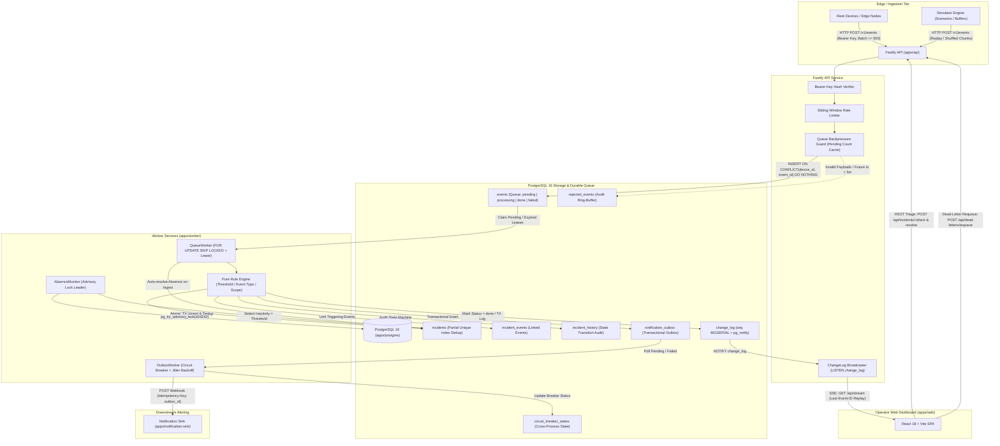

# Platform Architecture & Data Flow

The Real-Time Device Operations Platform is designed for high reliability, fault tolerance, and absolute correctness under failure. It uses **PostgreSQL 16 as the single source of truth and durable queue**, intentionally omitting complex message brokers (Kafka, Redis, RabbitMQ) to guarantee zero dual-write anomalies, transactional atomicity, and single-command local runnability.

---

## 1. Architecture Diagram



---

## 2. End-to-End Data Flow

### A. Device Ingestion & Backpressure Guard

1. **Transport**: Devices and the CLI simulator transmit JSON batches of up to 500 events over `POST /v1/events` using an `Authorization: Bearer <device_key>` header.
2. **Authentication**: The key is hashed using SHA-256 and matched against `devices.key_hash` using constant-time comparison.
3. **Backpressure**: Prior to ingestion, the API checks pending queue depth via a 1s cached query. If depth exceeds `QUEUE_BACKPRESSURE_THRESHOLD` (default: 5,000), the request is rejected with `429 Too Many Requests` + `Retry-After: 5`, protecting PostgreSQL memory and disk from saturation.
4. **Per-Event Idempotency**:
   - Each event is verified: `ts` cannot be > 5 minutes in the future; required fields (`event_id`, `seq`, `ts`, `type`, `payload`) must pass Zod schema validation.
   - Events are inserted into `events` with `ON CONFLICT (device_id, event_id) DO NOTHING`.
   - The response returns HTTP 200 with per-event status: `accepted`, `duplicate`, or `rejected`. Valid events committed to PostgreSQL are immediately assigned `processing_status = 'pending'`. Malformed events are written to `rejected_events`.

### B. Durable Queue & Lease Claim Cycle

1. **Fair Multi-Worker Claim**: Worker instances poll `events` every 500ms using:
   ```sql
   SELECT event_id, device_id, seq, ts, received_at, type, payload, attempts
   FROM events
   WHERE (processing_status = 'pending' AND (locked_until IS NULL OR locked_until <= NOW()))
      OR (processing_status = 'processing' AND locked_until < NOW())
   ORDER BY received_at ASC
   LIMIT $1
   FOR UPDATE SKIP LOCKED;
   ```
2. **Lease Extension**: Claimed rows transition to `processing_status = 'processing'` with `locked_until = NOW() + INTERVAL '30 seconds'`. Multiple worker replicas never collide or block each other.
3. **Poison-Pill & Dead-Letter Handling**: If an event fails unhandled during processing, worker increments `attempts`, sets exponential backoff, and records `last_error`. After `MAX_EVENT_ATTEMPTS` (default: 5), it moves to `processing_status = 'failed'`, remaining available for inspection and requeuing via `POST /api/dead-letters/requeue`.

### C. Rule Evaluation & Deduplication

1. **Rule Engine**: Evaluates active rules against the event and its device context:
   - **Threshold**: Numerical extraction via dot-notation (e.g., `payload.metrics.temperature > 80`).
   - **Event Type**: Exact match on event type string (e.g., `device.error`).
   - **Scope Resolution**: Applied across `all` devices, devices within a `location`, or an individual `device`.
2. **Audit Logging**: Every evaluation is persisted to `rule_evaluations (event_id, rule_id, matched, reason)` for explainability.
3. **Atomic Incident Upsert**: If a rule matches, the worker performs atomic dedup in a single transaction:
   ```sql
   INSERT INTO incidents (
     id, dedup_key, rule_id, device_id, status, severity,
     last_event_id, occurrence_count, summary, opened_at, first_seen_at, last_seen_at
   )
   VALUES ($1, $2, $3, $4, 'open', $5, $6, 1, $7, NOW(), NOW(), NOW())
   ON CONFLICT (dedup_key) WHERE status IN ('open', 'acknowledged')
   DO UPDATE SET
     occurrence_count = incidents.occurrence_count + 1,
     last_seen_at = NOW(),
     last_event_at = NOW(),
     last_event_id = EXCLUDED.last_event_id,
     updated_at = NOW()
   RETURNING id, (xmax = 0) AS is_new, severity, occurrence_count;
   ```
4. **Trigger Event Association**: Links `event_id` to `incident_events` and records state transition in `incident_history`.
5. **Completion**: In the **same database transaction**, the worker marks the event `processing_status = 'done'`, clears `locked_until`, writes a row to `change_log`, and commits.

### D. Absence Detection & Auto-Resolution

1. **Leader Election via PostgreSQL Advisory Lock**: Only one worker instance executes `AbsenceMonitor` using `pg_try_advisory_lock(424242)`. If the leader dies, another worker claims the lock immediately.
2. **Heartbeat Silence Detection**: Compares each device's `last_seen_at` against active `absence` rules. Devices exceeding the silence threshold with no active incident have an absence incident created and status transitioned (`online` -> `stale` -> `offline`).
3. **Auto-Resolution on Resume**: Whenever any new event arrives from a silent device, the queue worker automatically resolves all open absence incidents for that device (`status = 'auto_resolved'`, `actor = 'device_resume'`) and writes an audit log entry.

### E. Transactional Outbox & Notification Resilience

1. **Transactional Outbox**: Notifications are inserted into `notification_outbox` in the same transaction as incident creation or severity escalation.
2. **Notifier Loop**: The `OutboxWorker` claims pending notifications using `FOR UPDATE SKIP LOCKED`.
3. **Circuit Breaker State Machine**:
   - Tracks consecutive webhook delivery failures per host.
   - If failures exceed threshold (`CIRCUIT_BREAKER_FAILURE_THRESHOLD=5`), the breaker trips to `OPEN`, persisting state to `circuit_breaker_states`.
   - While `OPEN`, outbound requests to that host are postponed without wasting network sockets or worker threads.
   - After `CIRCUIT_BREAKER_RESET_TIMEOUT_MS` (default: 30s), transitions to `HALF_OPEN` to probe receiver health.
4. **Delivery Guarantees**: Sends webhooks with header `Idempotency-Key: <outbox_id>`. Downstream sinks deduplicate identical delivery attempts.

### F. Real-Time Streaming & Replay

1. **Change-Data-Capture**: Every insert/update on `devices`, `incidents`, `rules`, and `events` appends to `change_log (seq BIGSERIAL, entity, op, data)`.
2. **LISTEN/NOTIFY Fan-Out**: PostgreSQL trigger executes `pg_notify('change_log')`. The Fastify API maintains a single persistent `LISTEN` connection and fans out SSE messages to connected web dashboards.
3. **Replay on Reconnect**: Dashboard clients connect to `GET /api/stream` with `Last-Event-ID: <seq>`. The server replays missed change log rows from PostgreSQL. If the gap exceeds 500 events, it signals `event: resync_required`, prompting the UI to refresh state via REST.
