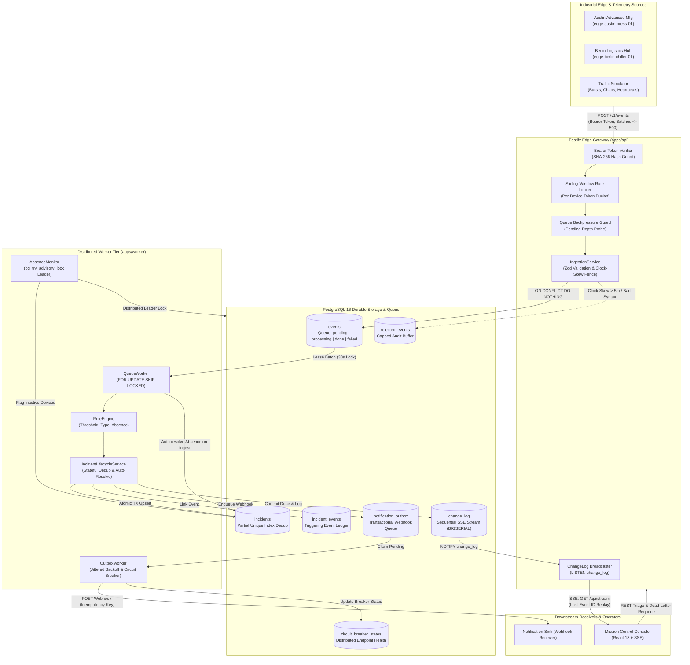

# Systems Architecture & Telemetry Pipeline Specification

## 1. Architectural Philosophy & Core Tenets

The Real-Time Operations Platform is designed from first principles for mission-critical edge deployments where hardware fleets transmit erratic, bursty telemetry over unreliable cellular and industrial networks.

The primary architectural mandate is **resilience through transactional simplicity**:

> **"Eliminate dual-write hazards and operational overhead by leveraging PostgreSQL 16 as both the durable state store and transactional queue."**

By avoiding an external messaging cluster (such as Apache Kafka, RabbitMQ, or Redis), the platform gains fundamental structural advantages:

- **Zero Dual-Write Anomalies**: An incident creation, its associated triggering event linkage, occurrence count increment, transactional outbox record, and event queue completion occur within **a single ACID database transaction**.
- **Deterministic Crash Recovery**: If a worker node crashes mid-batch, its database transaction unrolls cleanly; no orphaned queue acknowledgments or phantom database states can occur.
- **Single-Command Developer & Production Footprint**: The entire ecosystem boots deterministically via `docker compose up --build -d` without distributed state synchronization layers.

---

## 2. High-Level System Topology



---

## 3. In-Depth Subsystem Mechanics

### 3.1. Ingestion Gateway & Flow Control (`apps/api`)

The ingestion entry point (`POST /v1/events`) manages inbound traffic through four defensive checkpoints:

1. **Constant-Time Token Verification**:
   - Device requests transmit an `Authorization: Bearer <key>` header.
   - The token is hashed with SHA-256 and compared against `devices.key_hash` using `crypto.timingSafeEqual` to eliminate timing side-channel attacks.
2. **Per-Device Rate Limiting**:
   - Enforced by an in-memory sliding-window token bucket (default: 120 requests/minute per device).
   - Exceeded budgets trigger `HTTP 429 Too Many Requests` with a calculated `Retry-After` header.
3. **Queue Backpressure Sentry**:
   - Before accepting payload bytes into the database, the API inspects active queue depth (`SELECT COUNT(*) FROM events WHERE processing_status = 'pending'`).
   - If the queue exceeds `QUEUE_BACKPRESSURE_THRESHOLD` (default: 5,000 items), the endpoint immediately sheds load with `HTTP 429` and `Retry-After: 5`, shielding PostgreSQL memory and storage from write saturation.
4. **Isolated Schema & Clock-Skew Validation (`IngestionService`)**:
   - Evaluated by `EventIngestionEngine`:
     - Schema compliance via Zod (`event_id` UUIDv4, integer `seq >= 1`, ISO 8601 `ts`, JSON `payload`).
     - Clock skew safeguard: Rejects events timestamped more than 5 minutes in the future (`ts > NOW() + INTERVAL '5 minutes'`).
   - Rejected events are captured in `rejected_events` (a circular audit ring buffer) without failing valid sibling events in the batch.
   - Valid records are inserted with:
     ```sql
     INSERT INTO events (event_id, device_id, seq, ts, received_at, type, payload, processing_status)
     VALUES ($1, $2, $3, $4, NOW(), $5, $6, 'pending')
     ON CONFLICT (device_id, event_id) DO NOTHING;
     ```
   - Ingestion returns HTTP 200 with individual outcome objects: `[{ event_id, status: 'accepted' | 'duplicate' | 'rejected' }]`.

---

### 3.2. Relational Queue & Worker Lease Fencing (`apps/worker`)

Rather than relying on a separate message queue daemon, worker processes treat `events` as a transactional queue using PostgreSQL row-level locks:

```sql
SELECT event_id, device_id, seq, ts, received_at, type, payload, attempts
FROM events
WHERE (processing_status = 'pending' AND (locked_until IS NULL OR locked_until <= NOW()))
   OR (processing_status = 'processing' AND locked_until < NOW())
ORDER BY received_at ASC
LIMIT $1
FOR UPDATE SKIP LOCKED;
```

#### The Worker Concurrency & Fencing Guarantees:

- **Zero Lock Contention**: `SKIP LOCKED` instructs PostgreSQL to bypass any row currently locked by another worker transaction. Horizontal worker replicas scale without deadlock hazards.
- **Lease Fencing & Zombie Prevention**: Claimed rows are stamped with `locked_until = NOW() + INTERVAL '30 seconds'`. If a worker pauses (e.g. stop-the-world garbage collection or network freeze) and resumes after lease expiry, its completion query:
  ```sql
  UPDATE events SET processing_status = 'done', locked_until = NULL
  WHERE event_id = $1 AND (locked_until IS NULL OR locked_until >= NOW());
  ```
  will update 0 rows, triggering an atomic rollback and preventing stale overwrites.
- **Dead-Letter Handling**: If event processing raises an unhandled exception, `attempts` is incremented and `locked_until` is set using exponential backoff ($2^{\text{attempts}} \times 1\text{s}$). Upon reaching `MAX_EVENT_ATTEMPTS` (5), the record moves to `processing_status = 'failed'`, surfacing in operator dead-letter queues.

---

### 3.3. Pure Rule Engine & Stateful Lifecycle (`IncidentLifecycleService`)

Event evaluation is divided between pure condition checking and stateful incident lifecycle updates:

1. **Pure Functional Rule Evaluation (`RuleEngine`)**:
   - Threshold Rules: Evaluates dot-notation telemetry paths against operators (`>`, `>=`, `<`, `<=`, `==`, `!=`).
   - Event Type Rules: Direct string match against event classifications.
   - Audit Persistence: Every evaluation writes an immutable record to `rule_evaluations (event_id, rule_id, matched, reason)` for full explainability in the UI.
2. **Stateful Incident Deduplication**:
   - Active incidents maintain a deterministic deduplication key:
     $$\text{dedup\_key} = \text{rule\_id} : \text{device\_id}$$
   - When a rule triggers, `IncidentLifecycleService` executes an atomic upsert:
     ```sql
     INSERT INTO incidents (
       id, dedup_key, rule_id, device_id, status, severity,
       last_event_id, occurrence_count, summary, opened_at, first_seen_at, last_seen_at
     )
     VALUES ($1, $2, $3, $4, 'open', $5, $6, 1, $7, NOW(), NOW(), NOW())
     ON CONFLICT (dedup_key) WHERE status IN ('open', 'acknowledged')
     DO UPDATE SET
       occurrence_count = incidents.occurrence_count + 1,
       last_seen_at = NOW(),
       last_event_at = NOW(),
       last_event_id = EXCLUDED.last_event_id,
       updated_at = NOW()
     RETURNING id, (xmax = 0) AS is_new, severity, occurrence_count;
     ```
   - **Result**: Continuous threshold violations increment `occurrence_count` on the open incident and attach the triggering event to `incident_events`, completely preventing alert flooding.

---

### 3.4. Distributed Absence Detection & Leader Election

The platform actively detects silent devices that stop transmitting heartbeats:

1. **Advisory Lock Leader Election**:
   - A single worker assumes absence monitoring leadership by acquiring an application-level advisory lock:
     ```sql
     SELECT pg_try_advisory_lock(424242);
     ```
   - If the leader process terminates, PostgreSQL automatically releases the advisory lock, allowing a standby worker replica to claim leadership on its next poll cycle.
2. **Absence Rule Invariants**:
   - The monitor scans for devices whose $(NOW() - \text{last\_seen\_at}) > \text{timeout\_seconds}$.
   - Devices missing expected intervals transition status: $\text{online} \rightarrow \text{stale} \rightarrow \text{offline}$.
   - An absence incident is opened with severity `critical` or `warning`.
3. **Auto-Resolution on Reconnect**:
   - When a previously silent device resumes transmitting, `IncidentLifecycleService` detects the new event, identifies open absence incidents for that device, and automatically resolves them:
     $$\text{status} = \text{'auto\_resolved'}, \quad \text{actor} = \text{'device\_resume'}$$
   - Full audit trails are written to `incident_history`.

---

### 3.5. Transactional Outbox & Resilient Webhook Delivery

Outbound notifications must never be lost, even if external webhook endpoints experience extended outages:

1. **Transactional Outbox Capture**:
   - When an incident is opened or escalated, a notification record is inserted into `notification_outbox` inside the **exact same database transaction**.
2. **Outbox Worker Dispatch**:
   - `OutboxWorker` claims pending records using `FOR UPDATE SKIP LOCKED`.
   - Webhook dispatches include an `Idempotency-Key: <outbox_id>` header, allowing downstream endpoints to discard network duplicate attempts.
3. **Distributed Circuit Breaker (`circuit_breaker_states`)**:
   - Tracks consecutive failures on a per-host basis.
   - When failure count reaches `CIRCUIT_BREAKER_FAILURE_THRESHOLD` (5), the circuit trips to `OPEN`.
   - While `OPEN`, outbound requests to that host are paused, preventing socket exhaustion.
   - After `CIRCUIT_BREAKER_RESET_TIMEOUT_MS` (30s), the circuit enters `HALF_OPEN` to probe receiver health with a single canary request.
   - If successful, the circuit resets to `CLOSED`; if failing, it returns to `OPEN`.

---

### 3.6. Gapless Real-Time Streaming (SSE & `change_log`)

The operator dashboard in `apps/web` receives live updates without WebSocket infrastructure:

1. **Continuous Change Log**:
   - Database mutations on entities trigger writes to `change_log (seq BIGSERIAL, entity, op, data)`.
   - A PostgreSQL trigger invokes `pg_notify('change_log')`.
2. **Connection Handshake & Reconnection Catch-Up**:
   - Clients connect to `GET /api/stream` using HTML5 `EventSource`.
   - On reconnect, clients transmit `Last-Event-ID: <seq>`.
   - The API immediately queries:
     ```sql
     SELECT seq, entity, op, data FROM change_log WHERE seq > $1 ORDER BY seq ASC;
     ```
   - Replayed events catch the UI up before live events stream.
   - If the disconnect gap exceeds `SSE_REPLAY_LIMIT` (500 events), the API emits `event: resync_required`, prompting the UI to refresh its snapshot via REST.
3. **Storage Hygiene**:
   - Trigger `trg_cap_change_log` runs periodically to prune records older than 50,000 sequence IDs, keeping the log bounded while preserving a safe replay window.
